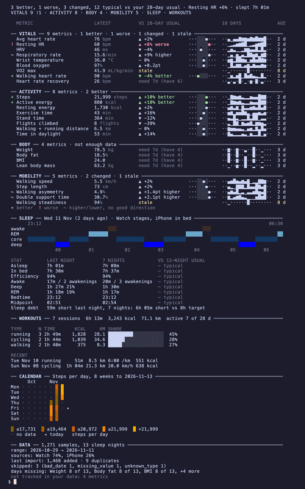
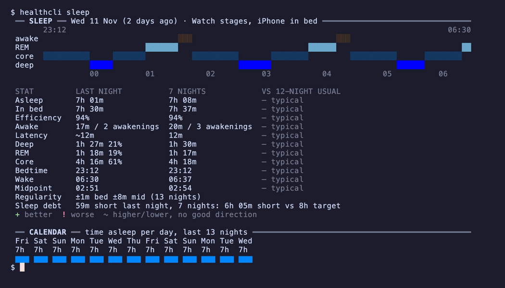
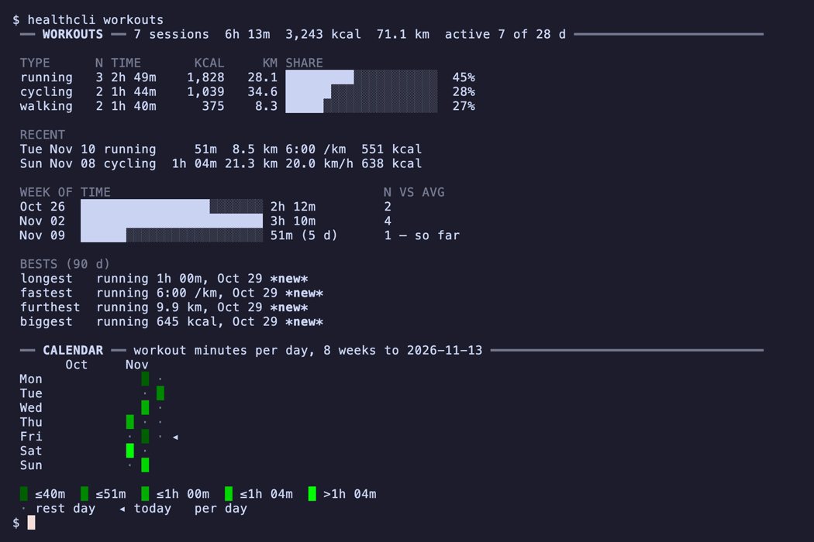
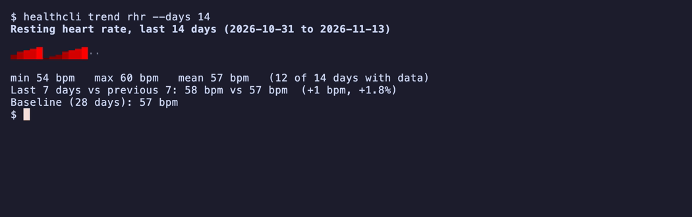

# healthcli

Import your Apple Health export into a SQLite database on your own machine, then look at it from the terminal: a one-screen overview, today's numbers against your baseline, sleep, workouts, calendar heatmaps, trends over time, and plain SQL for everything else.


> **Supported source (v0.1): Apple Health only.** Data from other apps and devices works only if it is written into Apple Health on your iPhone.

> **v0.1.0.** I use it on my own Apple Health export, but one person's data does not cover every device, so expect some rough edges and please report them. Every screenshot and output in this README comes from a generated sample person (made-up data, dates shifted to look current), never from real health data.

## What you get

- **`overview`**: every metric against your own 28-day usual, grouped as vitals, activity, body and mobility, with last night's sleep, recent workouts, an activity calendar and a health check of the data itself.
- **`today`**: one day's numbers against the 28 days before it.
- **`sleep`**: a hypnogram of last night, then 7-night and usual comparisons, bedtime regularity and sleep debt.
- **`workouts`**: totals per activity, weekly volume, personal bests and a calendar.
- **`heatmap`** and **`trend`**: a GitHub-style calendar and a sparkline for any metric.
- **`query`**: read-only SQL on your own data, with `--json` on every command for scripts.
- **Local and private**: one SQLite file, no network, no accounts. Output degrades to plain ASCII on a pipe and never relies on colour alone.

## Screenshots

All of these are real terminal output from `healthcli`, run on the sample data.

### Overview

Every metric, its change against your usual (in words as well as colour), a range gauge and a 4-week trend:



### Today

A single day against the 28 days before it, with that night's sleep:


### Sleep



### Workouts



### Heatmap and trend




## Usage cases

Short recipes. Each one is a real command; the full output of the main ones is shown further down.

### Look at your data for the first time

Export from the Health app (see below), import, then start with the overview:

```sh
healthcli import apple export.zip
healthcli overview
```

The bottom of the overview (`DATA`) tells you what was imported, over which dates, from which devices, and which metrics your data does not contain. If a number looks wrong, check there first.

### A quick morning check

```sh
healthcli today                  # yesterday or today, whichever has data, vs your usual
healthcli sleep                  # last night: stages, regularity, sleep debt
healthcli overview --compact --category vitals   # just the vitals, no blank lines
```

`!` in the left margin marks a metric that moved the wrong way against your own usual, `+` the right way, `~` a change with no good direction.

### Is my sleep slipping?

```sh
healthcli sleep --sleep-target 7h30m             # debt against your own target
healthcli sleep --nights 14 --by bedtime         # calendar coloured by bedtime
healthcli trend sleep --days 30                  # hours asleep per night
healthcli heatmap sleep --weeks 12
```

### Review your training

```sh
healthcli workouts                      # totals, weekly volume, bests, recent sessions
healthcli workouts --days 90 --by type  # calendar where each day shows its main activity
```

### Keep an eye on one number

```sh
healthcli trend rhr --days 30           # resting heart rate sparkline and 7-day change
healthcli trend weight --days 90
healthcli heatmap steps                 # 12 weeks of steps as a calendar
```

`healthcli trend --help` lists every metric and alias (`rhr`, `hrv`, `spo2`, `steps`, `weight`, ...).

### Check back on a past day

`--date` treats any day as today, on `today`, `trend`, `overview`, `sleep`, `workouts` and `heatmap`:

```sh
healthcli today --date 2026-03-14
healthcli overview --date 2026-03-14
```

### Keep it up to date

Health exports are full snapshots. Export again whenever you like and import the new file; what is already stored is skipped, so re-importing is always safe:

```sh
healthcli import apple export.zip --dry-run   # count only, write nothing
healthcli import apple export.zip
```

Between exports, add a reading by hand (and take it back if you mistyped):

```sh
healthcli log weight 72.5
healthcli log weight 72.5 --at "2026-11-01 08:30"
healthcli log --delete weight --at "2026-11-01 08:30"
```

### Ask your own questions with SQL

`query` runs one read-only `SELECT`. The tables are `samples`, `sleep_stages` and `workouts` (timestamps are UTC unix seconds):

```sh
# your five biggest step days
healthcli query "SELECT date(start_ts,'unixepoch') AS day, round(sum(value)) AS steps
                 FROM samples WHERE metric = 'step_count'
                 GROUP BY day ORDER BY steps DESC LIMIT 5"

# distance per workout type
healthcli query "SELECT activity, count(*) AS n, round(sum(distance_m)/1000,1) AS km
                 FROM workouts GROUP BY activity"
```

### Use it in scripts

Every command takes `--json`. Combined with `jq`:

```sh
# what changed for the worse or better today?
healthcli overview --json | jq -r '.metrics[] | select(.verdict=="better" or .verdict=="worse") | "\(.label): \(.verdict)"'

# average steps over the last 14 days
healthcli trend steps --days 14 --json | jq '.summary.mean'

# exit code 3 means "no database yet"
healthcli today >/dev/null 2>&1 || echo "run healthcli import apple first"
```

With `--json`, errors are printed as `{"error": {"code": ..., "message": ...}}` on stdout, so a script can tell them apart. Colour is off on a pipe, so you can also paste plain output into a note or an email.

### Work in another place or on a copy

```sh
healthcli --db ~/Documents/health-2026.db overview    # a specific database file
HEALTHCLI_DB=~/Documents/health-2026.db healthcli today
```

Read commands open the database read-only, so a backup copy on a read-only volume works.

## Privacy

- Everything stays on your computer. Your data lives in one SQLite file.
- No telemetry, no analytics, no accounts, no update checks.
- healthcli makes **no network connections**. It never needs to.
- Your export file is only ever read, never modified.

## Install

**Go** (needs Go 1.27.3 or newer, the version in `go.mod`; Go 1.21 and later download that toolchain on their own when `GOTOOLCHAIN` is `auto`, the default):

```sh
go install github.com/nmutto/healthcli/cmd/healthcli@latest
```

**Release binaries**: download the `tar.gz` for your system (macOS or Linux, Intel/amd64 or ARM/arm64) from the GitHub Releases page, check it against `checksums.txt`, and put `healthcli` somewhere on your `PATH`:

```sh
tar -xzf healthcli_*_darwin_arm64.tar.gz
sudo mv healthcli /usr/local/bin/
```

The release binaries are **not code-signed** (see the FAQ for the macOS workaround).

## Export your data from the iPhone

1. Open the **Health** app.
2. Tap your **profile picture** (top right).
3. Scroll down and tap **Export All Health Data**, then confirm.
4. Wait: a large history can take several minutes. Then share the resulting `export.zip` to your Mac (AirDrop works well).

You can pass `export.zip` straight to healthcli, or the `export.xml` inside it.

## Quickstart

The output below was produced by running `healthcli` on the sample in `testdata/small` (a made-up person, December 2024).

Import it (use `--db` to choose a database file; without it, healthcli uses a per-user default, see below):

```console
$ healthcli --db demo.db import apple testdata/small/export.xml
Read:       1480 records
Inserted:   1468
Duplicates: 3 (same key and value as a row already stored or earlier in the file)
Conflicts:  6 (same key, different value: the stored one was kept)
Skipped:    3
  bad_date             1
  missing_value        1
  unknown_type         1
Most common types not imported:
  HKQuantityTypeIdentifierSomethingFromTheFuture     1
Elapsed:    0.0s
```

Importing the same file again is safe and adds nothing:

```console
$ healthcli --db demo.db import apple testdata/small/export.xml
Read:       1480 records
Inserted:   0
Duplicates: 1471 (same key and value as a row already stored or earlier in the file)
Conflicts:  6 (same key, different value: the stored one was kept)
Skipped:    3
  ...
Backup:     demo.db.bak
```

Log a reading by hand:

```console
$ healthcli --db demo.db log weight 72.5
Logged body_mass = 72.5 kg at 2026-11-10 18:31
```

`log` checks what you type. A value must be a plain number (no hex, no underscores), not negative, and not zero except for steps and active energy; percentages are typed as 0-100 (`log spo2 97`; above 100 is refused, and a blood oxygen below 50 is refused with the hint "type 97 for 97%"); anything above 10,000,000 is refused; `--at` may be at most one day in the future. Every metric healthcli knows works (an unknown name lists them), and the aliases are `hr`, `hrv`, `rhr`, `rr`, `spo2`, `steps`, `temp`, `vo2`, `weight` and `bmi`. Weight is stored in kg (`--unit lb` converts).

One screen with every metric, last night's sleep, recent workouts, an activity calendar and how complete your data is (`overview`):

```console
$ healthcli --db demo.db overview
 healthcli overview                              db: demo.db · imported 1 d ago
 ──────────────────────────────────────────────────────────────────────────────
 3 better, 1 worse, 3 changed, 12 typical vs your 28-day usual · Resting HR +6%
 VITALS 9 !1 · ACTIVITY 8 · BODY 4 · MOBILITY 5 · SLEEP · WORKOUTS

   METRIC                      LATEST          VS 28-DAY USUAL               AGE

 ━━ VITALS ━━ 9 metrics · 1 better · 1 worse · 1 changed · 1 stale ━━━━━━━━━━━━
   Avg heart rate              76 bpm          ▲ +2%             ···░░░●···
 ! Resting HR                  60 bpm          ▲ +6% worse       ···░░░░●··
   HRV                         46 ms           ▼ -4%             ···░●░░···
 ~ Respiratory rate            15.6/min        ▲ +9% higher      ···░░░░●··
   Wrist temperature           36.0 °C         – 0%              ···░░●░···
   Blood oxygen                97%             ▲ +0.2pt          ···░░●░···
   VO2 max                     41.9 mL/kg/min  stale                         6 d
 + Walking heart rate          90 bpm          ▼ -4% better      ···●░░░···
   Heart rate recovery         26 bpm          need 7d (have 6)

 ━━ ACTIVITY ━━ 8 metrics · 2 better ━━━━━━━━━━━━━━━━━━━━━━━━━━━━━━━━━━━━━━━━━━
 + Steps                       21,999 steps    ▲ +10% better     ···░░░●···
 + Active energy               880 kcal        ▲ +10% better     ···░░░●···
   Resting energy              1,730 kcal      ▲ +2%             ···░░░●···
   Exercise time               43 min          ▲ +16%            ···░░●░···
   Stand time                  364 min         ▼ -12%            ···░●░░···
   Flights climbed             8 flights       ▼ -39%            ···●░░░···
   Walking + running distance  6.5 km          – 0%              ···░░●░···
   Time in daylight            53 min          ▲ +14%            ···░░●░···

 ━━ BODY ━━ 4 metrics · not enough data ━━━━━━━━━━━━━━━━━━━━━━━━━━━━━━━━━━━━━━━
   Weight                      78.5 kg         need 7d (have 4)
   Body fat                    18.5%           need 7d (have 4)
   BMI                         24.0            need 7d (have 4)
   Lean body mass              63.2 kg         need 7d (have 4)

 ━━ MOBILITY ━━ 5 metrics · 2 changed · 1 stale ━━━━━━━━━━━━━━━━━━━━━━━━━━━━━━━
   Walking speed               5.5 km/h        ▲ +2%             ···░░●░···
   Step length                 73 cm           ▲ +2%             ···░░░●···
 ~ Walking asymmetry           4.9%            ▲ +1.4pt higher   ···░░░░●··
 ~ Double support time         30.7%           ▲ +2.1pt higher   ···░░░░●··
   Walking steadiness          94%             stale                         6 d
 + better  ! worse  ~ higher/lower, no good direction

 ━━ SLEEP ━━ Sun 8 Nov · Watch stages, iPhone in bed ━━━━━━━━━━━━━━━━━━━━━━━━━━
       23:12                                                              06:30
 awake                       ░░░                        ░░
 REM                    ▓▓▓▓▓                      ▓▓▓▓▓                     ▓▓
 core  ▒▒▒▒▒▒▒▒    ▒▒▒▒▒        ▒▒▒▒▒▒▒▒     ▒▒▒▒▒▒       ▒▒▒▒▒▒▒▒▒    ▒▒▒▒▒▒
 deep          ████                     █████                      ████
              00        01        02        03        04        05        06

 STAT         LAST NIGHT          7 NIGHTS            VS 12-NIGHT USUAL
 Asleep       7h 01m              7h 08m              – typical
 In bed       7h 30m              7h 37m              – typical
 Efficiency   94%                 94%                 – typical
 Awake        17m / 2 awakenings  20m / 3 awakenings  – typical
 Deep         1h 27m 21%          1h 30m              – typical
 REM          1h 18m 19%          1h 17m              – typical
 Bedtime      23:12               23:12               – typical
 Midpoint     02:51               02:54               – typical
 Sleep debt   59m short last night, 7 nights: 6h 05m short vs 8h target

 ━━ WORKOUTS ━━ 7 sessions  6h 13m  3,243 kcal  71.1 km  active 7 of 28 d ━━━━━

 TYPE      N TIME       KCAL     KM SHARE
 running   3 2h 49m    1,828   28.1 █████████░░░░░░░░░░░  45%
 cycling   2 1h 44m    1,039   34.6 ██████░░░░░░░░░░░░░░  28%
 walking   2 1h 40m      375    8.3 █████░░░░░░░░░░░░░░░  27%

 RECENT
 Sat Nov 07 running     51m  8.5 km 6:00 /km  551 kcal
 Thu Nov 05 cycling  1h 04m 21.3 km 20.0 km/h 638 kcal
 Tue Nov 03 walking     28m  2.3 km 12:00 /km 104 kcal

 ━━ CALENDAR ━━ Steps per day, 12 weeks to 2026-11-08 ━━━━━━━━━━━━━━━━━━━━━━━━━
     Aug Sep     Oct     Nov
 Mon · · · · · · · · · · ▁ ▁
 Tue · · · · · · · · · · ▇ ▅
 Wed · · · · · · · · · · ▇ ▃
 Thu · · · · · · · · · · ▅ ▃
 Fri · · · · · · · · · · ▅ █
 Sat · · · · · · · · · · ▃ █
 Sun · · · · · · · · · · ▁ ▇ ◂

 ▁ ≤17,731  ▃ ≤19,464  ▅ ≤20,972  ▇ ≤21,999  █ >21,999
 · no data   ◂ today   steps per day

 ━━ DATA ━━ 1,271 samples, 14 sleep nights ━━━━━━━━━━━━━━━━━━━━━━━━━━━━━━━━━━━━
 range: 2026-10-26 → 2026-11-08
 sources: Watch 74%, iPhone 26%
 last import: 1,468 added · 9 duplicates
 skipped: 3 (bad_date 1, missing_value 1, unknown_type 1)
 days missing: Weight 8 of 13, Body fat 8 of 13, BMI 8 of 13, +4 more
 not tracked in your data: 4 metrics
```

The sample has a Watch and an iPhone, and its dates are shifted to look current. A device that records less gets fewer rows: metrics your data does not contain are never shown, only counted in the last line (`--json` lists them as `not_tracked`), and a database with no sleep or no workouts has no SLEEP or WORKOUTS section at all. Metrics are grouped in VITALS / ACTIVITY / BODY / MOBILITY bands; a `!` / `+` / `~` in the left gutter marks worse / better / higher-or-lower rows, and the index line under the headline counts the worse ones. `--category vitals,sleep` shows only some sections, `--compact` drops the blank lines and keeps a one-character `!` / `+` / `~` flag in the margin. Every page fits from 50 to 100 columns.

`overview --full` shows everything: the sleep table with every row, the weekly workout bars and personal bests, and a heatmap for sleep, workouts and activity. An excerpt (the middle of the page):

```console
$ healthcli --db demo.db overview --full
 ━━ SLEEP ━━ Sun 8 Nov · Watch stages, iPhone in bed ━━━━━━━━━━━━━━━━━━━━━━━━━━
       23:12                                                              06:30
 awake                       ░░░                        ░░
 REM                    ▓▓▓▓▓                      ▓▓▓▓▓                     ▓▓
 core  ▒▒▒▒▒▒▒▒    ▒▒▒▒▒        ▒▒▒▒▒▒▒▒     ▒▒▒▒▒▒       ▒▒▒▒▒▒▒▒▒    ▒▒▒▒▒▒
 deep          ████                     █████                      ████
              00        01        02        03        04        05        06

 STAT         LAST NIGHT          7 NIGHTS            VS 12-NIGHT USUAL
 Asleep       7h 01m              7h 08m              – typical
 In bed       7h 30m              7h 37m              – typical
 Efficiency   94%                 94%                 – typical
 Awake        17m / 2 awakenings  20m / 3 awakenings  – typical
 Latency      ~12m                12m                 – typical
 Deep         1h 27m 21%          1h 30m              – typical
 REM          1h 18m 19%          1h 17m              – typical
 Core         4h 16m 61%          4h 18m              – typical
 Bedtime      23:12               23:12               – typical
 Wake         06:30               06:37               – typical
 Midpoint     02:51               02:54               – typical
 Regularity   ±1m bed ±8m mid (13 nights)
 Sleep debt   59m short last night, 7 nights: 6h 05m short vs 8h target
 + better  ! worse  ~ higher/lower, no good direction

 ━━ CALENDAR ━━ time asleep per day, last 13 nights ━━━━━━━━━━━━━━━━━━━━━━━━━━━
 Tue Wed Thu Fri Sat Sun Mon Tue Wed Thu Fri Sat Sun
 7h  7h  7h  7h  7h  7h  7h  7h  7h  7h  7h  7h  7h
 ▆▆▆ ▆▆▆ ▆▆▆ ▆▆▆ ▆▆▆ ▆▆▆ ▆▆▆ ▆▆▆ ▆▆▆ ▆▆▆ ▆▆▆ ▆▆▆ ▆▆▆

 ━━ WORKOUTS ━━ 7 sessions  6h 13m  3,243 kcal  71.1 km  active 7 of 28 d ━━━━━

 TYPE      N TIME       KCAL     KM SHARE
 running   3 2h 49m    1,828   28.1 █████████░░░░░░░░░░░  45%
 cycling   2 1h 44m    1,039   34.6 ██████░░░░░░░░░░░░░░  28%
 walking   2 1h 40m      375    8.3 █████░░░░░░░░░░░░░░░  27%

 RECENT
 Sat Nov 07 running     51m  8.5 km 6:00 /km  551 kcal
 Thu Nov 05 cycling  1h 04m 21.3 km 20.0 km/h 638 kcal
 Tue Nov 03 walking     28m  2.3 km 12:00 /km 104 kcal

 BESTS (90 d)
 longest   running 1h 00m, Oct 26 *new*
 fastest   running 6:00 /km, Oct 26 *new*
 furthest  running 9.9 km, Oct 26 *new*
 biggest   running 645 kcal, Oct 26 *new*

 ━━ CALENDAR ━━ workout minutes per day, 12 weeks to 2026-11-08 ━━━━━━━━━━━━━━━
     Aug Sep     Oct     Nov
 Mon                     ▅ ·
 Tue                     · ▁
 Wed                     █ ·
 Thu                     · ▇
 Fri                     ▁ ·
 Sat                     · ▃
 Sun                     ▅ · ◂

 ▁ ≤40m  ▃ ≤51m  ▅ ≤1h 00m  ▇ ≤1h 04m  █ >1h 04m
 · rest day   ◂ today   per day
  ...
```

The same full sections are available on their own as `healthcli sleep` and `healthcli workouts`.

Each metric is compared with its own 28-day usual and shows its own newest day and age. When a value is beyond your usual (1+ standard deviation, and a change of at least 2% or a small per-metric minimum) it is coloured by which direction is generally healthy for that metric: **green** and the word "better", **red** and "worse". Metrics with no good direction (weight, respiratory rate, wrist temperature) have no colour and say "higher" or "lower" in plain text. Every beyond-usual row has its word, so nothing depends on colour; typical rows are plain. The legend names the margin markers, so it reads the same without colour. Stale readings are yellow. The legend is the line under the table. Walking double support time and walking asymmetry are judged by their level: a rise that stays inside the range (up to 40% for double support, Apple's typical walking range; up to 35% for asymmetry) says only "higher" or "lower", leaving it is "worse" and coming back is "better". Metrics that are themselves a percentage show their change in points (`pt`), not a relative percent. Three metrics also have a reference limit for the level itself (resting heart rate above 100 bpm, respiratory rate above 20/min, blood oxygen below 95%): when the latest value is outside it, a plain dim note under that category says so (for example "Blood oxygen 93% is below the usual adult level of 95% (general guide, not medical advice)"). The note never colours a row or changes its word, because a level against a population is not a change against your own usual; watch readings are estimates, and this is not medical advice. The double support (40%) and walking asymmetry (35%) limits give the same kind of note, under MOBILITY (for example "Double support time 45.0% is above 40.0%, the top of Apple's typical walking range"). Walking steadiness has no range: Apple publishes no numeric cut-offs.

> The better/worse direction is a general guide, not medical advice. What is healthy for one person (an athlete's low resting heart rate, deliberate weight change) can differ.

The calendar at the end shows daily steps (else exercise time, else active energy); `--weeks N` sets its length (default 12, `0` hides all calendars) and `--heatmap steps,sleep,workouts,METRIC` draws exactly the calendars you name, in that order. On a pipe, or with `--ascii`, the output is plain ASCII; `--no-color` and `NO_COLOR` turn colour off, and `--json` prints the same report as JSON, including each metric's polarity, verdict and `range` (for the metrics that have one), `not_tracked` and the heatmap grid. `--category` narrows the JSON the same way as the text: only the chosen categories' metrics and counts, and the `sleep` and `workouts` parts only when named. `sleep.state` is `ok`, `stale`, `no_data` or `in_bed_only` (a latest night with in-bed time but no sleep stages). The workouts figures in the overview (headline, table) cover the last 28 days.

A day's summary against your recent baseline: `today` is a one-day slice of the overview (same bands, gutter markers, colours and widths), with a USUAL column (your 28-day usual before that day) instead of the trend line:

```console
$ healthcli --db demo.db today --date 2026-11-08
 Sunday 2026-11-08 (yesterday)
 ──────────────────────────────────────────────────────────────────────────────
 3 better, 1 worse, 3 changed, 12 typical vs your 28-day usual · Resting HR +6%
 VITALS 7 !1 · ACTIVITY 8 · MOBILITY 4 · SLEEP

   METRIC                      LATEST        USUAL   VS USUAL

 ━━ VITALS ━━ 7 metrics · 1 better · 1 worse · 1 changed ━━━━━━━━━━━━━━━━━━━━━━
   Avg heart rate              76 bpm        75      ▲ +2%            ···░░░●···
 ! Resting HR                  60 bpm        57      ▲ +6% worse      ···░░░░●··
   HRV                         46 ms         48      ▼ -4%            ···░●░░···
 ~ Respiratory rate            15.6/min      14.3    ▲ +9% higher     ···░░░░●··
   Wrist temperature           36.0 °C       35.9    – 0%             ···░░●░···
   Blood oxygen                97%           97      ▲ +0.2pt         ···░░●░···
 + Walking heart rate          90 bpm        94      ▼ -4% better     ···●░░░···

 ━━ ACTIVITY ━━ 8 metrics · 2 better ━━━━━━━━━━━━━━━━━━━━━━━━━━━━━━━━━━━━━━━━━━
 + Steps                       21,999 steps  19,955  ▲ +10% better    ···░░░●···
 + Active energy               880 kcal      798     ▲ +10% better    ···░░░●···
   Resting energy              1,730 kcal    1,701   ▲ +2%            ···░░░●···
   Exercise time               43 min        37      ▲ +16%           ···░░●░···
   Stand time                  364 min       411     ▼ -12%           ···░●░░···
   Flights climbed             8 flights     13      ▼ -39%           ···●░░░···
   Walking + running distance  6.5 km        6.5     – 0%             ···░░●░···
   Time in daylight            53 min        47      ▲ +14%           ···░░●░···

 ━━ MOBILITY ━━ 4 metrics · 2 changed ━━━━━━━━━━━━━━━━━━━━━━━━━━━━━━━━━━━━━━━━━
   Walking speed               5.5 km/h      5.4     ▲ +2%            ···░░●░···
   Step length                 73 cm         72      ▲ +2%            ···░░░●···
 ~ Walking asymmetry           4.9%          3.5     ▲ +1.4pt higher  ···░░░░●··
 ~ Double support time         30.7%         28.6    ▲ +2.1pt higher  ···░░░░●··
 + better  ! worse  ~ higher/lower, no good direction
 7 tracked metrics have no reading on this day

 ━━ SLEEP ━━ Sun 8 Nov · Watch stages, iPhone in bed ━━━━━━━━━━━━━━━━━━━━━━━━━━
       23:12                                                              06:30
 awake                       ░░░                        ░░                     
 REM                    ▓▓▓▓▓                      ▓▓▓▓▓                     ▓▓
 core  ▒▒▒▒▒▒▒▒    ▒▒▒▒▒        ▒▒▒▒▒▒▒▒     ▒▒▒▒▒▒       ▒▒▒▒▒▒▒▒▒    ▒▒▒▒▒▒  
 deep          ████                     █████                      ████        
              00        01        02        03        04        05        06

 STAT         LAST NIGHT          7 NIGHTS            VS 12-NIGHT USUAL
 Asleep       7h 01m              7h 08m              – typical
 In bed       7h 30m              7h 37m              – typical
 Efficiency   94%                 94%                 – typical
 Awake        17m / 2 awakenings  20m / 3 awakenings  – typical
 Deep         1h 27m 21%          1h 30m              – typical
 REM          1h 18m 19%          1h 17m              – typical
 Bedtime      23:12               23:12               – typical
 Midpoint     02:51               02:54               – typical
 Sleep debt   59m short last night, 7 nights: 6h 05m short vs 8h target
```

`today` uses the same category bands, gutter markers (`!` worse, `+` better, `~` changed), colours and 50–100 column widths as `overview`, and the same index line under the headline (without a "not tracked" tail). Each row reads LATEST, USUAL and VS USUAL, with the range gauge after the delta when it fits; the 28-day usual is the 28 days before that day, and sleep's usual is the nights before the one shown. Only metrics with a reading on that day get a row; one dim line counts the tracked metrics with none, and a day with no workouts has no WORKOUTS section. Sleep belongs to the date it ends on, counting sleep that ends after 18:00 as the next day's night.

Without `--date`, `today` shows today; if that day has no data at all, the latest day with data is shown instead, with a dim line saying so (`No data for 2026-11-09; showing 2026-11-08, the latest day with data`). A future date is an error. `--category`, `--compact`, `--ascii` and `--no-color` work as in `overview`; `--category` narrows the text and `--json` alike. `--json` keeps its documented fields (see `healthcli today --help`) and adds category, polarity, verdict, usual, `range` (the same object as in the overview, only for metrics with a reference range), `categories`, `tracked_without_reading` and `sleep_summary`. The day shown falls back to the latest day with data, but never past today's date.

A metric over time:

```console
$ healthcli --db demo.db trend steps --days 14 --date 2024-12-14
Steps, last 14 days (2024-12-01 to 2024-12-14)

▁▇▆▅▆▃▂▂▅▄▄█▇▇

min 16,525 steps   max 23,283 steps   mean 20,101 steps   (14 of 14 days with data)
Last 7 days vs previous 7: 20,640 steps vs 19,563 steps  (+1,078 steps, +5.5%)
Baseline (28 days): 20,101 steps
```

`trend` takes any metric of the registry (about 30, plus `sleep` for hours asleep per night) and the aliases above; `healthcli trend --help` lists them all. With colour on, the trend bars use the same palette as the heatmaps: the metric's hue (heart red, respiratory cyan, sleep blue, body purple and violet, orange for activity), dim for low days and bright for high ones. On a pipe, or with `--ascii`, the sparkline uses plain characters (`_` marks a day without data); `--no-color` turns colour off; lines never run past the terminal width (50 to 100 columns). The baseline is the 28 days before the last day shown, the same as in `overview` and `today`. The example above is a real run on the small fixture in a terminal; on a pipe the sparkline reads `.#*+*-::+==@##`.

Plain SQL. The database is opened read-only and `query` takes exactly one `SELECT`, `WITH` or `EXPLAIN` statement (a trailing `;` and leading comments are fine; a second statement, `PRAGMA` and `ATTACH` are refused). The example below ran after the `log weight` above, hence 6 `body_mass` rows:

```console
$ healthcli --db demo.db query "SELECT metric, count(*) AS n FROM samples GROUP BY metric ORDER BY n DESC"
metric                            n
step_count                        448
heart_rate                        330
active_energy                     224
oxygen_saturation                 28
apple_exercise_time               14
apple_sleeping_wrist_temperature  14
apple_stand_time                  14
basal_energy                      14
distance_walking_running          14
flights_climbed                   14
hrv_sdnn                          14
respiratory_rate                  14
resting_heart_rate                14
time_in_daylight                  14
walking_asymmetry                 14
walking_double_support            14
walking_heart_rate_average        14
walking_speed                     14
walking_step_length               14
heart_rate_recovery_one_minute    7
body_mass                         6
body_fat_percentage               5
body_mass_index                   5
lean_body_mass                    5
apple_walking_steadiness          2
vo2_max                           2
```

Commands that only read (`query`, `today`, `overview`, `sleep`, `workouts`, `heatmap`, `trend`) never create a database: with a wrong path they stop with `database not found: <path>; run "healthcli import apple <export.zip>" first`. Only `import` and `log` create the file.

Every command accepts `--json` for scripts (field names are per command; see each `--help`):

```console
$ healthcli --db demo.db query "SELECT metric, count(*) AS n FROM samples GROUP BY metric ORDER BY n DESC LIMIT 2" --json
[
  {"metric": "step_count", "n": 448},
  {"metric": "heart_rate", "n": 330}
]
```

### Calendar heatmap

`healthcli heatmap [metric]` draws a GitHub-style calendar: a row per weekday, a column per week, newest on the right. Each day is one coloured block, and the colour intensity is the metric's own quintile over the window (green for workouts, orange for steps and other activity, blue for sleep); the legend gives the actual cut points. Without colour (a pipe, `NO_COLOR`, `--ascii`) the blocks fall back to five heights so the level is still readable. A day without data is a dot, never the lowest shade; `◂` marks today. The default metric is `step_count`, `--weeks` sets the maximum (default 12; a narrow terminal drops the oldest weeks), and `--json` prints the grid.

Sample data (made-up step counts):

```console
$ healthcli heatmap
━━ CALENDAR ━━ Steps per day, 12 weeks to 2026-11-04 ━━━━━━━━━━━━━━━━━━━━━━━━━━━
    Aug Sep     Oct     Nov
Mon █ ▇ ▅ ▃ ▁ ▇ ▅ ▃ ▁ █ ▅ ▃
Tue ▇ ▅ ▃ ▁ █ ▅ ▃ ▁ █ ▇ ▅ ▁
Wed ▅ ▃ ▁ █ ▇ ▅ ▁ █ ▇ ▅ ▃ ▁ ◂
Thu ▅ ▁ █ ▇ ▅ ▃ ▁ ▇ ▅ ▃ ▁
Fri ▃ ▁ ▇ ▅ ▃ ▁ █ ▅ ▃ ▁ █
Sat ▁ █ ▅ ▃ ▁ █ ▇ ▅ ▁ █ ▇
Sun █ ▇ ▅ ▁ █ ▇ ▅ ▃ ▁ ▇ ▅

▁ ≤4,950  ▃ ≤6,900  ▅ ≤9,500  ▇ ≤11,450  █ >11,450
· no data   ◂ today   steps per day
```

On a pipe or with `--ascii` the same chart uses plain characters:

```console
$ healthcli heatmap --ascii
== CALENDAR == Steps per day, 12 weeks to 2026-11-04 ===========================
    Aug Sep     Oct     Nov
Mon @ # + - . # + - . @ + -
Tue # + - . @ + - . @ # + .
Wed + - . @ # + . @ # + - . <
Thu + . @ # + - . # + - .
Fri - . # + - . @ + - . @
Sat . @ + - . @ # + . @ #
Sun @ # + . @ # + - . # +

. <=4,950  - <=6,900  + <=9,500  # <=11,450  @ >11,450
_ no data   < today   steps per day
```

### Workouts

`healthcli workouts [--days N] [--weeks N] [--by type]` shows totals per activity type with a share bar, weekly training time (the current week is marked and gets no change figure), personal bests over 90 days (an activity needs 3 sessions), every session of the last 7 days (RECENT: today included, newest first; with a shorter `--days` it covers only that window) and a calendar of workout minutes per day, where empty days after your first workout are rest days. `--by type` draws each day's main activity as a letter. Columns with no data (no calories or distance recorded) disappear, and with no workouts you get one line, not an error. `--json` prints the report (durations in seconds; values that are absent are left out, never `null`).

Sample data:

```console
$ healthcli workouts
 ━━ WORKOUTS ━━ 16 sessions  16h 44m  6,820 kcal  187.5 km  active 16 of 28 d ━

 TYPE      N TIME       KCAL     KM SHARE
 cycling   6 7h 57m    3,450  126.0 ██████████░░░░░░░░░░  48%
 running   5 5h 00m    2,740   49.6 ██████░░░░░░░░░░░░░░  30%
 walking   3 2h 09m      630   11.9 ███░░░░░░░░░░░░░░░░░  13%
 yoga      2 1h 38m        -      - ██░░░░░░░░░░░░░░░░░░  10%

 RECENT
 Sat Nov 07 cycling  1h 07m 21.0 km 18.8 km/h 550 kcal
 Fri Nov 06 walking     33m  4.3 km 7:40 /km  210 kcal
 Wed Nov 04 running  1h 10m 11.0 km 6:22 /km  580 kcal

 WEEK OF TIME                                    N VS AVG
 Sep 21  █████████████░░░░░░░░░░░ 3h 00m         3 ▼ -23%
 Sep 28  ██████████████░░░░░░░░░░ 3h 13m         4 ▼ -12%
 Oct 05  ████████████░░░░░░░░░░░░ 2h 50m         4 ▼ -24%
 Oct 12  ████████████████████████ 5h 31m         5 ▲ +62%
 Oct 19  ██████████████░░░░░░░░░░ 3h 17m         3 ▼ -10%
 Oct 26  █████████████████░░░░░░░ 3h 54m         4 ▲ +5%
 Nov 02  ██████████████████░░░░░░ 4h 02m         4 ▲ +4%
 Nov 09  ░░░░░░░░░░░░░░░░░░░░░░░░ 0m (1 d)       0 – so far

 BESTS (90 d)
 longest   cycling 1h 32m, Oct 13 *new*
 fastest   running 3:11 /km, Sep 30
 furthest  cycling 21.0 km, Sep 03
 biggest   cycling 700 kcal, Sep 23

 ━━ CALENDAR ━━ workout minutes per day, 8 weeks to 2026-11-09 ━━━━━━━━━━━━━━━━
       Oct     Nov
 Mon · ▅ ▁ · · · █ · ◂
 Tue · · · █ ▅ ▁ ·
 Wed ▇ ▁ ▁ · · █ ▇
 Thu · ▃ ▃ ▅ · · ·
 Fri ▇ · · ▃ █ ▇ ▁
 Sat · ▅ ▁ ▅ · ▃ ▇
 Sun ▃ · · █ ▅ · ·

 ▁ ≤45m  ▃ ≤49m  ▅ ≤1h 00m  ▇ ≤1h 10m  █ >1h 10m
 · rest day   ◂ today   per day
```

### Where is my data?

If you don't pass `--db`, the database is `healthcli.db` in:

- `$HEALTHCLI_DB`, if you set it (a full file path), otherwise
- `$XDG_DATA_HOME/healthcli/`, if `XDG_DATA_HOME` is set, otherwise
- macOS: `~/Library/Application Support/healthcli/`
- elsewhere: `~/.local/share/healthcli/`

Delete that file to start over.

### Sleep

`healthcli sleep` shows last night as a hypnogram (awake, REM, core and deep over the night; a short awakening still shows), then last night, your last 7 nights and the change against your usual: the `--nights` nights (default 28) BEFORE the night shown, the same rule in `sleep`, `overview` and `today` (the 7- and 14-night figures include the night shown), with bedtime regularity and sleep debt against `--sleep-target` (default `8h`). A calendar of the nights follows (`--weeks`, `0` hides it; `--by asleep|bedtime|efficiency`); with fewer than 14 nights you get a small bar per night instead. Only what your data holds is shown: a device that records just "asleep" gets a single bar, in-bed time alone is not counted as a night of sleep and shows no sleep numbers, and rows without data are left out (one dim `not available:` line names them). Green is better, red worse, always with a word; rows with no good direction (bedtime, in bed) have no colour and say later/earlier, longer/shorter or higher/lower. A night is the sleep that ends on a date (18:00 to 18:00). Output below is from the sample data.

```
$ healthcli sleep
 ━━ SLEEP ━━ Wed 4 Nov · Watch stages, iPhone in bed ━━━━━━━━━━━━━━━━━━━━━━━━━━
       00:05                                                              06:00
 awake                                      ░                  ░
 REM                                    ▓▓▓▓             ▓▓▓▓▓▓           ▓▓▓▓▓
 core  ▒▒▒▒▒▒▒▒▒▒▒▒▒▒         ▒▒▒▒▒▒▒▒▒▒     ▒▒▒▒▒▒▒▒▒▒▒▒       ▒▒▒▒▒▒▒▒▒▒
 deep                █████████
                  01          02          03          04          05

 STAT         LAST NIGHT          7 NIGHTS            VS 28-NIGHT USUAL
 Asleep       5h 50m              6h 08m              ▼ -11% worse
 In bed       6h 03m              6h 29m              ▼ -13% shorter
 Efficiency   96%                 94%                 – typical
 Awake        5m / 2 awakenings   9m / 2 awakenings   – typical
 Latency      ~8m                 11m                 – typical
 Deep         45m 13%             45m                 – typical
 REM          1h 15m 21%          1h 14m              – typical
 Core         3h 50m 66%          4h 08m              ▼ -16% shorter
 Bedtime      00:05               23:58               ▲ +50m later
 Wake         06:00               06:15               – typical
 Midpoint     03:03               03:07               ▲ +26m later
 Regularity   ±51m bed ±34m mid (14 nights)           ▲ worse than usual (±38m)
 Sleep debt   2h 10m short last night, 7 nights: 13h 07m short vs 8h target
 + better  ! worse  ~ higher/lower, no good direction

 ━━ CALENDAR ━━ time asleep per day, 12 weeks to 2026-11-04 ━━━━━━━━━━━━━━━━━━━
     Aug Sep     Oct     Nov
 Mon · · · · · · ▁ ▅ ▇ ▅ ▇ ▁
 Tue · · · · · · ▇ ▃ ▇ ▃ ▇ ▁
 Wed · · · · · · ▅ ▃ ▅ ▁ ▇ ▁ ◂
 Thu · · · · · · ▅ ▇ ▅ ▇ ▁
 Fri · · · · · · ▃ ▇ ▃ ▇ ▁
 Sat · · · · · ▅ ▇ ▅ ▇ ▇ ▃
 Sun · · · · · ▃ ▇ ▃ ▇ ▇ ▁

 ▁ ≤6h 36m  ▃ ≤6h 52m  ▅ ≤7h 10m  ▇ ≤7h 20m
 · no data   ◂ today   per day
```

With only "asleep" data (no stages, no in-bed):

```
$ healthcli sleep
 ━━ SLEEP ━━ Wed 4 Nov · iPhone, no stages (unspecified asleep only) ━━━━━━━━━━
 ▒▒▒▒▒▒▒▒▒▒▒▒▒▒▒▒▒▒▒▒▒▒▒▒▒▒▒▒▒▒▒▒▒▒▒▒▒▒▒▒▒▒▒▒▒▒▒▒▒▒▒▒▒▒▒▒▒▒▒▒▒▒▒▒▒▒▒▒▒▒▒▒▒▒▒▒▒▒
 asleep 5h 55m   00:05 → 06:00   midpoint 03:03           (stages not recorded)

 STAT         LAST NIGHT          6 NIGHTS            VS USUAL
 Asleep       5h 55m              6h 18m              need 7 nights (have 5)
 Bedtime      00:05               00:00               need 7 nights (have 5)
 Wake         06:00               06:18               need 7 nights (have 5)
 Midpoint     03:03               03:09               need 7 nights (have 5)
 Regularity   ±19m bed ±13m mid (6 nights)
 Sleep debt   2h 05m short last night, 6 nights: 10h 15m short vs 8h target
 not available: in bed, efficiency, awake, latency, deep, REM, core

 ━━ CALENDAR ━━ time asleep per day, last 6 nights ━━━━━━━━━━━━━━━━━━━━━━━━━━━━
 Fri Sat Sun Mon Tue Wed
 6h  7h  7h  6h  6h  6h
 ▅▅▅ ▆▆▆ ▆▆▆ ▅▅▅ ▅▅▅ ▅▅▅
```

## Safety, exit codes and options

- **Import is safe to repeat and to interrupt.** `import apple` checks the file before it touches the database, copies an existing database to `<db>.bak` first (skip with `--no-backup`), and `--dry-run` reads and counts everything without writing. Ctrl-C stops after the last whole batch and says so. A damaged byte in the export (invalid UTF-8) is replaced and counted, not fatal. Records that clash with a stored one are counted as `Duplicates` when identical and as `Conflicts` when the value differs (the stored value is kept).
- **Sources are told apart by device.** The import keeps Apple's device model, so a renamed Watch is still a Watch. Re-importing an older export fills in the model for rows that lack it.
- **Plausible values only.** `import` and `log` share one range per metric (for example heart rate above 0 and up to 300 bpm). `log` refuses times before 1990, more than a day ahead, and times that do not exist or happen twice at a daylight-saving change (give an offset such as `+01:00`). `healthcli log --delete hr --at "2025-03-01 08:30"` removes a reading you typed; imported rows cannot be deleted this way.
- **`query` is bounded.** It streams rows, shows 1000 by default (`--limit N`, `0` for all) and stops after 30 s (`--timeout`).
- **`--date YYYY-MM-DD`** treats that day as today on `today`, `trend`, `overview`, `sleep`, `workouts` and `heatmap`.
- **Exit codes:** 0 success, 1 runtime error, 2 usage error, 3 database not found. With `--json` an error is printed as `{"error": {"code": ..., "message": ...}}` on stdout.
- **Read-only copies work.** Read commands open the database without writing when nothing needs upgrading, so a backup copy or a read-only mount can be read. A database written by a newer healthcli is refused with a clear message; upgrading an older one prints `upgrading database to schema N` on stderr.

## Shell completions

Generate completions for your shell:

```sh
# zsh (add to ~/.zshrc, after compinit)
source <(healthcli completion zsh)

# bash
source <(healthcli completion bash)

# fish
healthcli completion fish > ~/.config/fish/completions/healthcli.fish
```

Release archives also ship ready-made files in `completions/`.

## FAQ and limitations

**Which data wins if my Watch and iPhone both record steps?** The Apple Watch takes priority over the iPhone, so you aren't double-counted. Overlapping sleep records are merged and duplicate workouts from two sources are collapsed.

**Has it been tested on real exports?** Yes, on my own Apple Health export. The automated tests and all screenshots use sample data generated by `tools/genfixtures`, so no real health data is in this repository. Other devices and iOS versions record different things; if something breaks on yours, I'd like to know.

**Why does macOS say the app can't be opened / is from an unidentified developer?** The release binaries are not signed or notarized for v0.1. After downloading, remove the quarantine flag once:

```sh
xattr -d com.apple.quarantine /path/to/healthcli
```

Installing with `go install` avoids this.

**Does it write to my Health app?** No. It reads an export file and writes only its own SQLite database.

**Which Health data is supported?** Sleep, workouts and about 30 metrics: heart rate, resting and walking heart rate, heart rate recovery, HRV, respiratory rate, blood oxygen, wrist temperature, VO2 max, blood pressure, blood glucose, steps, distance, flights, exercise, stand and daylight time, active and resting energy, body mass, body fat, BMI, lean body mass, height, and the walking metrics (speed, step length, asymmetry, double support, steadiness). The registry in `internal/metrics` is the full list, and `healthcli trend --help` prints the names. Other record types are skipped and counted in the import summary (`unknown_type`), and the most common ones are listed after it.

## Development

```sh
go build ./cmd/healthcli
go vet ./...
go test -race ./...
```

Generate synthetic fixtures (no real data is ever needed or committed):

```sh
go run ./tools/genfixtures --size small --seed 1 --out testdata/small --flat
```

Regenerate the screenshots and demo GIF in `docs/media/` (needs [VHS](https://github.com/charmbracelet/vhs) and `sqlite3`; the scripts are the `.tape` files next to them):

```sh
tools/media.sh
```

Try a local release build without publishing anything:

```sh
goreleaser release --snapshot --clean --skip=publish
```

See [docs/design.md](docs/design.md) for how the code is organised. Changes are listed in [CHANGELOG.md](CHANGELOG.md).

## Licence

[MIT](LICENSE) © Niccolo Muttoni
