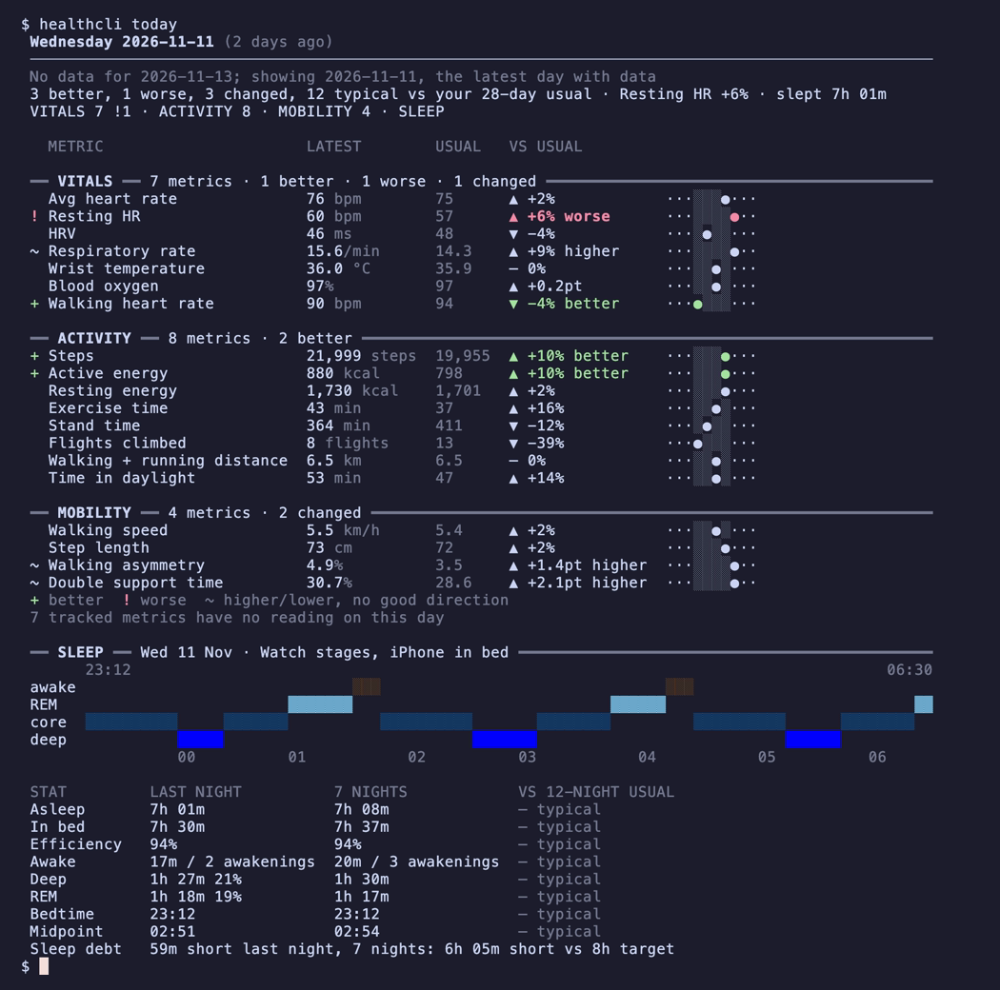
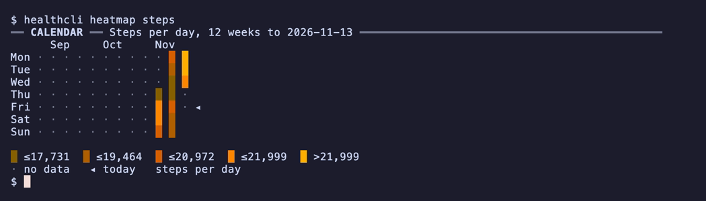

# healthcli

Import your Apple Health export into a SQLite database on your own machine, then look at it from the terminal: a one-screen overview, today's numbers against your baseline, sleep, workouts, calendar heatmaps, trends over time, and plain SQL for everything else.


> **Apple Health only, for now.** healthcli reads Apple Health exports. Data from other apps and devices works if it is written into Apple Health on your iPhone. This is an early release, used on my own export so far: expect some rough edges, and please report them.

## What you get

- **`overview`**: every metric against your own 28-day usual, grouped as vitals, activity, body and mobility, with last night's sleep, recent workouts, an activity calendar and a health check of the data itself.
- **`today`**: one day's numbers against the 28 days before it.
- **`sleep`**: a hypnogram of last night, then 7-night and usual comparisons, bedtime regularity and sleep debt.
- **`workouts`**: totals per activity, weekly volume, personal bests and a calendar.
- **`heatmap`** and **`trend`**: a GitHub-style calendar and a sparkline for any metric.
- **`query`**: read-only SQL on your own data, with `--json` on every command for scripts.
- **Local and private**: one SQLite file, no network, no accounts. Output degrades to plain ASCII on a pipe and never relies on colour alone.

## Install

**Go** (needs Go 1.27.3 or newer, the version in `go.mod`; Go 1.21 and later download that toolchain on their own when `GOTOOLCHAIN` is `auto`, the default):

```sh
go install github.com/nmutto/healthcli/cmd/healthcli@latest
```

This puts `healthcli` in `$(go env GOBIN)`, or in `~/go/bin` if that is unset. Make sure that folder is on your `PATH`.

**Release binaries**: download the `tar.gz` for your system (macOS or Linux, Intel/amd64 or ARM/arm64) from the GitHub Releases page, check it against `checksums.txt`, and put `healthcli` somewhere on your `PATH`:

```sh
shasum -a 256 -c checksums.txt --ignore-missing
tar -xzf healthcli_*_darwin_arm64.tar.gz
sudo mv healthcli /usr/local/bin/
```

The release binaries are **not code-signed** (see the FAQ for the macOS workaround).

## Export your data from the iPhone

1. Open the **Health** app.
2. Tap your **profile picture** (top right).
3. Scroll down and tap **Export All Health Data**, then confirm.
4. Wait: a large history can take several minutes. Then share the resulting `export.zip` to your Mac (AirDrop works well).

You can pass `export.zip` straight to healthcli, or the `export.xml` inside it.

## Quickstart

```sh
healthcli import apple export.zip
healthcli overview
healthcli today
```

The bottom of the overview (`DATA`) shows what was imported, over which dates, from which devices, and which metrics your data does not contain. If a number looks wrong, check there first. Add `--db path/to/file.db` to any command to choose a database file; without it healthcli uses a per-user default (see [Where is my data](#where-is-my-data)).

Every command and its output is shown in the [command reference](docs/commands.md).

## What it looks like

Screenshots and examples use a generated sample person (made-up data, dates shifted to look current), never real health data.

### Overview

Every metric, its change against your usual (in words as well as colour), a range gauge and a 4-week trend:


### Today

A single day against the 28 days before it, with that night's sleep:



### Sleep


### Workouts


### Heatmap and trend




## Examples

Short recipes. The [command reference](docs/commands.md) has the full output of each command.

### A quick morning check

```sh
healthcli today                  # yesterday or today, whichever has data, vs your usual
healthcli sleep                  # last night: stages, regularity, sleep debt
healthcli overview --compact --category vitals   # just the vitals, no blank lines
```

`!` in the left margin marks a metric that moved the wrong way against your own usual, `+` the right way, `~` a change with no good direction.

### Is my sleep slipping?

```sh
healthcli sleep --sleep-target 7h30m             # debt against your own target
healthcli sleep --nights 14 --by bedtime         # calendar coloured by bedtime
healthcli trend sleep --days 30                  # hours asleep per night
healthcli heatmap sleep --weeks 12
```

### Review your training

```sh
healthcli workouts                      # totals, weekly volume, bests, recent sessions
healthcli workouts --days 90 --by type  # calendar where each day shows its main activity
```

### Keep an eye on one number

```sh
healthcli trend rhr --days 30           # resting heart rate sparkline and 7-day change
healthcli trend weight --days 90
healthcli heatmap steps                 # 12 weeks of steps as a calendar
```

`healthcli trend --help` lists every metric and alias (`rhr`, `hrv`, `spo2`, `steps`, `weight`, ...).

### Check back on a past day

`--date` treats any day as today, on `today`, `trend`, `overview`, `sleep`, `workouts` and `heatmap`:

```sh
healthcli today --date 2026-03-14
healthcli overview --date 2026-03-14
```

### Keep it up to date

Health exports are full snapshots. Export again whenever you like and import the new file; what is already stored is skipped, so re-importing is always safe:

```sh
healthcli import apple export.zip --dry-run   # count only, write nothing
healthcli import apple export.zip
```

Between exports, add a reading by hand (and take it back if you mistyped):

```sh
healthcli log weight 72.5
healthcli log weight 72.5 --at "2026-11-01 08:30"
healthcli log --delete weight --at "2026-11-01 08:30"
```

### Ask your own questions with SQL

`query` runs one read-only `SELECT`. The tables are `samples`, `sleep_stages` and `workouts` (timestamps are UTC unix seconds):

```sh
# your five biggest step days
healthcli query "SELECT date(start_ts,'unixepoch') AS day, round(sum(value)) AS steps
                 FROM samples WHERE metric = 'step_count'
                 GROUP BY day ORDER BY steps DESC LIMIT 5"

# distance per workout type
healthcli query "SELECT activity, count(*) AS n, round(sum(distance_m)/1000,1) AS km
                 FROM workouts GROUP BY activity"
```

### Use it in scripts

Every command takes `--json`. Combined with `jq`:

```sh
# what changed for the worse or better today?
healthcli overview --json | jq -r '.metrics[] | select(.verdict=="better" or .verdict=="worse") | "\(.label): \(.verdict)"'

# average steps over the last 14 days
healthcli trend steps --days 14 --json | jq '.summary.mean'

# exit code 3 means "no database yet"
healthcli today >/dev/null 2>&1 || echo "run healthcli import apple first"
```

With `--json`, errors are printed as `{"error": {"code": ..., "message": ...}}` on stdout, so a script can tell them apart. Colour is off on a pipe, so you can also paste plain output into a note or an email.

### Work in another place or on a copy

```sh
healthcli --db ~/Documents/health-2026.db overview    # a specific database file
HEALTHCLI_DB=~/Documents/health-2026.db healthcli today
```

Read commands open the database read-only, so a backup copy on a read-only volume works.

## Where is my data?

If you don't pass `--db`, the database is `healthcli.db` in:

- `$HEALTHCLI_DB`, if you set it (a full file path), otherwise
- `$XDG_DATA_HOME/healthcli/`, if `XDG_DATA_HOME` is set, otherwise
- macOS: `~/Library/Application Support/healthcli/`
- elsewhere: `~/.local/share/healthcli/`

Delete that file to start over.

## Privacy

- Everything stays on your computer. Your data lives in one SQLite file.
- No telemetry, no analytics, no accounts, no update checks.
- healthcli makes **no network connections**. It never needs to.
- Your export file is only ever read, never modified.

## Shell completions

Generate completions for your shell:

```sh
# zsh (add to ~/.zshrc, after compinit)
source <(healthcli completion zsh)

# bash
source <(healthcli completion bash)

# fish
healthcli completion fish > ~/.config/fish/completions/healthcli.fish
```

Release archives also ship ready-made files in `completions/`.

## FAQ and limitations

**Which data wins if my Watch and iPhone both record steps?** The Apple Watch takes priority over the iPhone, so you aren't double-counted. Overlapping sleep records are merged and duplicate workouts from two sources are collapsed.

**Has it been tested on real exports?** Yes, on my own Apple Health export. The automated tests and all screenshots use sample data generated by `tools/genfixtures`, so no real health data is in this repository. Other devices and iOS versions record different things; if something breaks on yours, I'd like to know.

**Why does macOS say the app can't be opened / is from an unidentified developer?** The release binaries are not signed or notarized for v0.1. After downloading, remove the quarantine flag once:

```sh
xattr -d com.apple.quarantine /path/to/healthcli
```

Installing with `go install` avoids this.

**Does it write to my Health app?** No. It reads an export file and writes only its own SQLite database.

**Which Health data is supported?** Sleep, workouts and about 30 metrics: heart rate, resting and walking heart rate, heart rate recovery, HRV, respiratory rate, blood oxygen, wrist temperature, VO2 max, blood pressure, blood glucose, steps, distance, flights, exercise, stand and daylight time, active and resting energy, body mass, body fat, BMI, lean body mass, height, and the walking metrics (speed, step length, asymmetry, double support, steadiness). The registry in `internal/metrics` is the full list, and `healthcli trend --help` prints the names. Other record types are skipped and counted in the import summary (`unknown_type`), and the most common ones are listed after it.

## Development

```sh
go build ./cmd/healthcli
go vet ./...
go test -race ./...
```

Generate synthetic fixtures (no real data is ever needed or committed):

```sh
go run ./tools/genfixtures --size small --seed 1 --out testdata/small --flat
```

Regenerate the screenshots and demo GIF in `docs/media/` (needs [VHS](https://github.com/charmbracelet/vhs) and `sqlite3`; the scripts are the `.tape` files next to them):

```sh
tools/media.sh
```

See [docs/design.md](docs/design.md) for how the code is organised. Changes are listed in [CHANGELOG.md](CHANGELOG.md).

## Licence

[MIT](LICENSE) © Niccolo Muttoni
